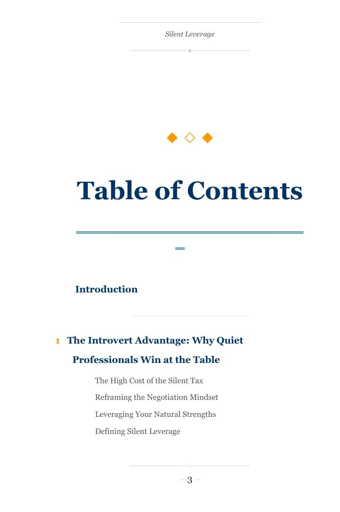
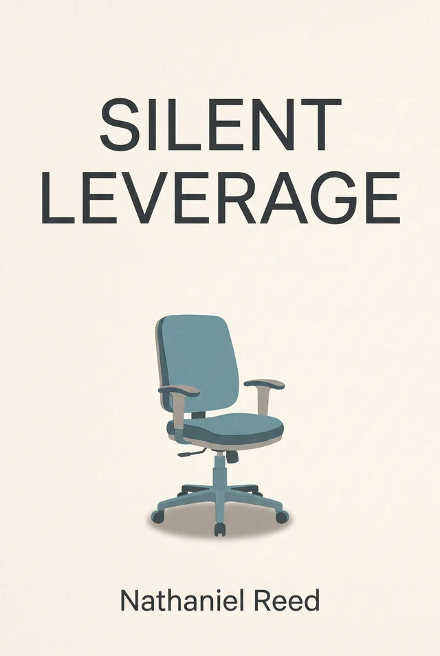
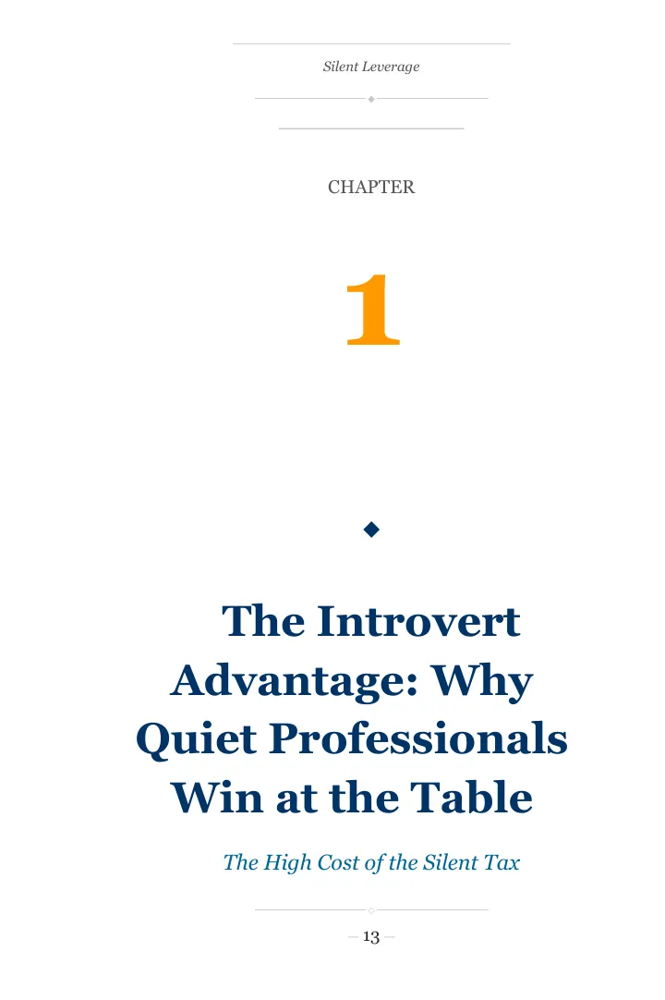

# DraftToDone — AI book generator for Amazon KDP

> One sentence in. A complete KDP book out, in about 30 minutes: manuscript,
> 6×9 interior PDF, full wrap cover and listing. You review it, then you publish.

[**Preview your book, free**](https://app.drafttodone.io/signup?utm_source=github&utm_medium=readme) · [**drafttodone.io**](https://drafttodone.io) · [**Guides**](https://drafttodone.io/en/blog)

[](https://drafttodone.io)
[](https://app.drafttodone.io)
[](https://drafttodone.io)

<p align="center">
  <a href="https://drafttodone.io/#sample">
    
    
    
  </a>
  <br>
  <em>Silent Leverage, 132 pages. A real book DraftToDone generated from one brief, shown as generated.
  <a href="https://drafttodone.io/#sample">Leaf through it</a>.</em>
</p>

**DraftToDone** is an AI book generator for **Amazon Kindle Direct Publishing (KDP)**.
ChatGPT gives you text in a chat window; you still have to plan the chapters, lay out
the interior, build a cover whose spine fits the page count and write the listing.
DraftToDone does that whole job from one brief.

## What you get from one brief

- **Editable Word manuscript** — the engine plans the book, then writes it chapter by chapter.
- **6×9 interior PDF**, laid out for KDP print.
- **Front cover and the full KDP wrap PDF** — back, spine and front, sized to the page count.
- **The listing** — title, subtitle, description, 7 keywords and 3 categories.
- **An invented pen name**, which you check yourself before publishing.

## How it works

1. **Write your brief.** One or two sentences: who the book is for and what it promises them.
2. **See a free preview** in about a minute: title, promise, pen name and cover. No credit card.
3. **Get the whole book** in about 30 minutes (20 to 45), written from that exact preview.

## Pricing

| Plan | Price | What it buys |
|------|-------|--------------|
| Pay per book | €10 a book | 1 credit = 1 complete book. No subscription, credits never expire. |
| Weekly | €14.99 a week | 2 books a week, about €7.50 a book. |
| Yearly | €390 a year | About €3.75 a book. |

A credit is spent only when the book is finished: a failed generation costs nothing.

## What it does not promise

No sales forecast and no guarantee that Amazon accepts a book. You publish from your
own KDP account, you read every book before it goes up, and you declare AI-generated
content as KDP requires. Royalties go straight to you; DraftToDone takes no cut.

## Free KDP tools (no signup)

| Tool | What it does |
|------|--------------|
| [KDP royalty calculator](https://drafttodone.io/en/kdp-royalty-calculator) | Ebook and paperback royalties before you set a price |
| [KDP interior formatter](https://drafttodone.io/en/kdp-interior-formatter) | Turns a .docx into a print-ready 6×9 interior PDF, in the browser |
| [KDP description formatter](https://drafttodone.io/en/book-description-generator) | Formats an Amazon description in the HTML KDP accepts |
| [KDP title checker](https://drafttodone.io/en/book-title-generator) | Scores a title and subtitle before you publish |
| [KDP keyword slots checker](https://drafttodone.io/en/kdp-keyword-tool) | Checks the 7 backend keyword slots |
| [KDP cover template](https://drafttodone.io/en/ai-book-cover-generator) | Cover dimensions and spine width for a page count |

## For AI agents

DraftToDone can be driven end to end by an agent; the only human steps are payment
and publishing.

- MCP server: `https://app.drafttodone.io/mcp` (tools: status, create book, list books, download links)
- Agent guide: [`app.drafttodone.io/llms.txt`](https://app.drafttodone.io/llms.txt) · [`drafttodone.io/llms.txt`](https://drafttodone.io/llms.txt)

## Guides

- [How to write a book with AI — complete guide](https://drafttodone.io/en/blog/how-to-write-a-book-with-ai-complete-guide)
- [How to self-publish a book on Amazon, step by step](https://drafttodone.io/en/blog/how-to-self-publish-a-book-on-amazon-step-by-step)
- [How to choose KDP keywords](https://drafttodone.io/en/blog/how-to-choose-kdp-keywords-beginner-guide)
- [Best AI book writing tools, compared](https://drafttodone.io/en/blog/best-ai-book-writing-tools-compared)
- [All guides](https://drafttodone.io/en/blog)

## How DraftToDone compares

- [**AI book generators for Amazon KDP: 7 tools, sorted by the job each one does**](./AI-BOOK-GENERATORS-FOR-KDP.md) — KDP Builder, Inkfluence, Youbooks, Sudowrite, Atticus, Publisher Rocket and DraftToDone, with prices.
- [DraftToDone vs Sudowrite](https://drafttodone.io/en/sudowrite-alternative) — the whole publishable product vs AI fiction craft.
- [DraftToDone vs Atticus](https://drafttodone.io/en/atticus-alternative) — generate the book vs format one you wrote.
- [DraftToDone vs getebook.ai](https://drafttodone.io/en/getebook-alternative)

## Languages

The site is in English, French, Italian and German:
[EN](https://drafttodone.io) · [FR](https://drafttodone.io/fr) · [IT](https://drafttodone.io/it) · [DE](https://drafttodone.io/de).
Books are written in English or French.

This repository is the public marketing site ([drafttodone.io](https://drafttodone.io)).
The product runs at [app.drafttodone.io](https://app.drafttodone.io).

---

## Development

This repo is the **marketing site** (static, no backend). The app is a separate codebase.

**Stack:** Next.js 15 (App Router, static export) · Tailwind CSS v4 · lucide-react ·
next/font (Newsreader + Hanken Grotesk) · `next/og` for build-time share images.
Aesthetic: see [`DESIGN.md`](./DESIGN.md).

```bash
npm install
npm run dev      # http://localhost:3000
npm run build    # static export → ./out
```

**Content** lives in TypeScript (not a CMS):

- `app/home-content.ts` — landing copy (en/fr/it/de) + `APP_URL`; `app/home-view.tsx` — landing UI.
- `app/blog-content.ts` + `app/*-seo-posts.ts` — the blog.
- `app/seo-pages.ts` — solution / tool / comparison pages.

`sitemap.xml`, `robots.txt`, `feed.xml`, `manifest.webmanifest`, `llms.txt`,
`llms-full.txt`, `ai.txt`, `content-index.json`, `answer-engine.json` and OG images
are generated from that data. The SEO
playbook, prompt library and audit live in [`seo/`](./seo).

**i18n:** four locales, URL-based — landing at `/`, `/fr`, `/it`, `/de`; blog at
`/[locale]/blog`; solution pages at `/[locale]/[slug]`.

**Deploy:** push to `main` → `.github/workflows/deploy.yml` builds and publishes
`out/` to GitHub Pages. Custom domain via `public/CNAME` (drafttodone.io).

## Topics

`ai-publishing` · `amazon-kdp` · `self-publishing` · `ai-book-generator` ·
`book-cover-generator` · `kdp-keywords` · `nextjs` · `seo`
